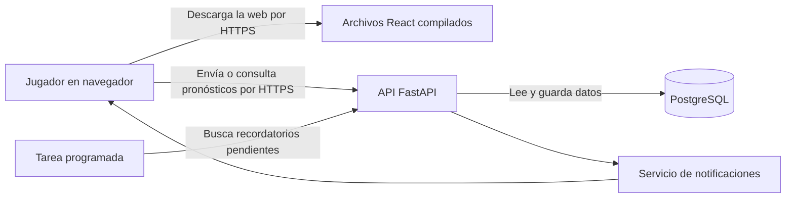
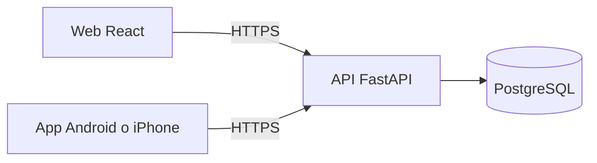

# PRODE - Guía de despliegue y aprendizaje

**Fecha de consulta:** 18 de noviembre de 2026.  
**Estado:** anexo educativo y propuesta de recorrido; proveedores todavía no elegidos.  
**Relación con Discovery:** complementa el Discovery aprobado el 17 de noviembre; no modifica sus decisiones ni afirma que la aplicación esté desplegada.

El stack acordado es React + TypeScript + Vite, Python + FastAPI y PostgreSQL. Primero construiremos una web jugable con amigos, apuntando a no pagar servicios durante las pruebas. Android/iPhone y la comercialización para empresas o suscriptores son una evolución posterior.

Esta guía explica cómo publicar ese producto, qué aprender y qué decisiones faltan. No es un registro de acciones ejecutadas ni una configuración lista para copiar en el proyecto: todavía no se implementó el nuevo MVP en la raíz del repositorio.

## 1. Qué significa desplegar

Mientras desarrollás, tu computadora ejecuta la aplicación. Si la apagás, los demás no pueden usar lo que depende de ella. Desplegar significa preparar una versión y publicarla en servicios accesibles por Internet, con su configuración y datos correspondientes.

No consiste sólo en subir archivos: también hay que comprobar que la aplicación inicia, puede conectarse a la base, responde por HTTPS y conserva los datos después de una actualización. Más adelante agregaremos pruebas automáticas y un procedimiento de recuperación. [Conceptos de despliegue de FastAPI](https://fastapi.tiangolo.com/deployment/concepts/)

| Término | Qué significa en PRODE |
|---|---|
| Frontend | Las pantallas con las que interactúa el jugador. El navegador ejecuta el JavaScript de React. |
| Backend o API | El programa FastAPI que recibe solicitudes, comprueba permisos y aplica reglas. |
| Base de datos | PostgreSQL, donde persistimos torneos, participantes, partidos y pronósticos. |
| Hosting o alojamiento | El servicio que publica archivos o mantiene disponible un programa. |
| Build | Preparar el código para distribuirlo. Vite genera archivos web; una app móvil requiere una compilación específica. |
| Dominio | El nombre legible que escribe una persona para llegar al producto. |
| DNS | Los registros que relacionan nombres y servicios de Internet. |
| HTTPS | La conexión cifrada entre cliente y servidor. No sustituye los permisos de la aplicación. |
| Variable de entorno | Un valor de configuración que cambia entre tu computadora y los servidores. Algunas variables son secretos; otras son públicas. |
| Migración | Un cambio versionado en la estructura de la base de datos. |
| CI/CD | Comprobaciones y pasos automatizados para preparar y publicar nuevas versiones. |
| Staging | Un entorno de ensayo separado de producción. |

El dominio de Namecheap puede seguir registrado allí aunque la aplicación esté alojada en otro proveedor. Registrar un dominio, alojar la web y ejecutar una API son servicios distintos. [Namecheap: conectar un dominio](https://www.namecheap.com/support/knowledgebase/article.aspx/9837/46/how-to-connect-a-domain-to-a-server-or-hosting/)

## 2. Cómo se conectarían nuestras partes

Las flechas representan responsabilidades. No requieren que cada caja sea un servidor propio ni que contratemos un proveedor por caja. La ubicación de las tareas programadas y del envío de notificaciones todavía debe decidirse.

### Ejemplo: guardar un pronóstico

1. Abrís la dirección de PRODE y tu navegador descarga la web.
2. Escribís 2-1 para un partido de uno de tus torneos.
3. La web envía una solicitud a FastAPI con tu sesión y el pronóstico.
4. FastAPI comprueba quién sos, si participás en ese torneo y si el partido sigue abierto.
5. El backend guarda el cambio en PostgreSQL y responde que se guardó.
6. La interfaz muestra la confirmación. Otro torneo conserva su pronóstico independiente.

Una pantalla podría ocultar el botón de edición después del inicio, pero es FastAPI quien debe rechazar un envío fuera de plazo. La base de datos no debe confiar en que todos los clientes se comporten como la interfaz oficial.

### Direcciones posibles, sólo como ejemplo

- `app.tudominio.me`: la web.
- `api.tudominio.me`: la API.
- La base tiene una dirección técnica que usa el backend; no es una página para jugadores.

Estos nombres son ilustrativos: no conocemos el nombre real del dominio ni configuramos DNS. Podemos empezar con las direcciones gratuitas que entrega cada plataforma y conectar el dominio después de comprobar que todo funciona.

## 3. Una ruta gratuita viable para el piloto

La siguiente combinación es una candidata para comparar, no una contratación ni una elección aprobada:

| Pieza | Candidato | Qué resolvería | Condición principal |
|---|---|---|---|
| Web | Cloudflare Pages Free | Publicar los archivos generados por Vite, con HTTPS y dominio propio. | Respetar cuotas de compilaciones y archivos; no ejecuta nuestro servidor Python tradicional. |
| API | Render Free Web Service | Instalar dependencias y ejecutar FastAPI desde un repositorio. | Se suspende sin tráfico y tiene un arranque posterior lento. |
| PostgreSQL | Neon Free | Base relacional gestionada independiente del servidor de la API. | Cuotas de almacenamiento y cómputo; el cómputo puede detenerse por inactividad. |
| PostgreSQL, alternativa | Supabase Free | PostgreSQL gestionado y posibles servicios adicionales de identidad. | Cuotas, pausa por baja actividad y estrategia propia de copias. |
| Código y automatización | GitHub y las integraciones de los proveedores | Versiones, revisión y preparación de despliegues. | Configurar accesos y límites; conectar Git no garantiza por sí solo que las pruebas bloqueen publicaciones defectuosas. |

Cloudflare documenta la configuración React/Vite como compilación `npm run build` y salida `dist`. Render tiene un recorrido oficial para FastAPI. Esos datos describen sus plataformas; los comandos finales del repositorio se determinarán cuando exista la implementación. [Cloudflare: compilación](https://developers.cloudflare.com/pages/configuration/build-configuration/) · [Render: FastAPI](https://render.com/docs/deploy-fastapi)

### Límites que importan

- **Render Free:** suspende el servicio después de 15 minutos sin tráfico y el siguiente arranque puede tardar alrededor de un minuto. Su disco local es efímero. No guardaríamos allí la base ni archivos de usuario que deban sobrevivir a reinicios. [Render Free](https://render.com/docs/free)
- **Render PostgreSQL Free:** expira a los 30 días; por eso no es una base gratuita permanente adecuada para nuestro piloto. [Límite de base gratuita](https://render.com/docs/free#30-day-limit)
- **Neon Free:** la página consultada ofrece 1 GB y 100 CU-horas mensuales por proyecto. CU-horas mide capacidad de cómputo multiplicada por tiempo activo; no es cantidad de usuarios. El cómputo gratuito se suspende tras inactividad. [Planes de Neon](https://neon.com/pricing)
- **Supabase Free:** incluye 500 MB de base y puede pausar el proyecto por baja actividad durante una semana. No debemos dar por incluidas las mismas copias administradas que en un plan pago. [Planes](https://supabase.com/pricing) · [Pausas](https://supabase.com/docs/guides/platform/free-project-pausing) · [Copias](https://supabase.com/docs/guides/platform/backups)

Gratis significa que podemos operar dentro de las condiciones del plan, no que haya disponibilidad garantizada ni capacidad ilimitada. Las cuotas y las condiciones pueden cambiar: se verificarán de nuevo antes de crear servicios.

### Cómo elegir Neon o Supabase

- Si sólo necesitamos alojar PostgreSQL para una API FastAPI propia, Neon es una opción directa para evaluar.
- Si también queremos comparar autenticación y otros componentes gestionados, Supabase merece una evaluación conjunta.
- En ambos casos las reglas de PRODE siguen requiriendo diseño y pruebas. Elegir proveedor de base no decide automáticamente cómo autenticaremos a los usuarios.
- La conexión necesita SSL, límites de conexiones y, cuando corresponda, un pooler. En Supabase hay diferencias entre conexión directa IPv6 y modos de pooler IPv4: debemos usar la modalidad compatible con el alojamiento real. [Conexiones de Supabase](https://supabase.com/docs/guides/database/connecting-to-postgres)

El backup no queda resuelto por tener la base fuera de Render. Necesitamos exportar, guardar una copia fuera del mismo proyecto y demostrar que puede restaurarse.

## 4. Publicar todo junto o separado

| Alternativa | Ventajas | Trabajo o límites |
|---|---|---|
| Web en Pages, API en Render y base externa | La web puede cargar aunque la API esté arrancando; cada parte tiene su publicación y recursos. | Dos direcciones, configuración de llamadas web/API y despliegues que debemos coordinar. |
| FastAPI sirve también el build de React; base externa | Una sola dirección y publicación para interfaz/API; puede simplificar el primer ejercicio de despliegue. | Si el servidor gratuito duerme, la web también espera. Hay que preparar el build web dentro del proceso de publicación. |
| Un VPS con web, API y quizá base | Control del entorno y posibilidad de alojar varios componentes. | Configurar y mantener sistema operativo, HTTPS, actualizaciones, firewall, procesos y recuperación. No sería mi primer paso para una persona que aún está aprendiendo despliegue. |

FastAPI admite servir archivos frontend compilados. La separación puede ser útil, pero no es una obligación para considerar profesional la aplicación. [Frontend en FastAPI](https://fastapi.tiangolo.com/tutorial/frontend/)

**Orientación para aprender:** primero publicaría una API mínima y una página mínima por separado, para entender las conexiones. Después elegiríamos la distribución del MVP según la experiencia de uso, los recordatorios y las condiciones gratuitas verificadas.

## 5. Qué pasos tendría el primer despliegue

### Paso A - Reproducir el sistema localmente

Preparar instrucciones para levantar frontend, API y PostgreSQL local, con versiones de herramientas definidas y variables documentadas. Empezaríamos con datos de ensayo. El código de `Contexto/` es un antecedente; no se presupone que esté listo para publicar.

**Comprobación:** otra persona, o una instalación limpia, puede seguir las instrucciones sin conocer detalles que sólo están en tu computadora.

### Paso B - Crear un entorno remoto de ensayo

Elegir región, crear la base, configurar credenciales sólo del lado servidor y aplicar las migraciones. Publicar la API con una ruta de comprobación de estado.

**Comprobación:** la API responde por HTTPS y guarda/recupera un dato de prueba. Reiniciar o actualizar la API no borra ese dato.

### Paso C - Publicar la web y conectarla

Generar el build, publicarlo y darle la dirección pública de la API. Si web y API tienen orígenes distintos, configurar CORS para los orígenes permitidos. CORS regula lo que permite el navegador; no sustituye autenticación o autorización. [Vite: despliegue](https://vite.dev/guide/static-deploy) · [FastAPI: CORS](https://fastapi.tiangolo.com/tutorial/cors/)

**Comprobación:** abrir la web desde otro dispositivo, iniciar sesión, guardar un pronóstico y volver a consultarlo.

### Paso D - Conectar el dominio

Asociar primero el dominio en la plataforma de alojamiento y después configurar los registros DNS que indique. Para Pages, un subdominio puede usar un CNAME en un DNS externo; el dominio raíz requiere incorporar la zona a Cloudflare y apuntar sus nameservers. El dominio puede seguir registrado en Namecheap. [Dominios en Pages](https://developers.cloudflare.com/pages/configuration/custom-domains/)

Antes de cambiar nameservers, revisar los registros existentes, especialmente si hay correo o servicios funcionando. No se realizará ningún cambio DNS como parte de esta guía.

### Paso E - Automatizar una publicación controlada

Definir qué rama produce una versión candidata, qué pruebas deben pasar, quién publica y cómo comprobar el resultado. Una propuesta para el piloto es probar primero y aprobar manualmente la publicación; más adelante automatizar la promoción cuando el recorrido sea confiable.

**Comprobación:** una versión que falla las pruebas no se publica y queda claro qué revisión está ejecutándose. [Full Stack Open: CI/CD](https://fullstackopen.com/es/part11/introduccion_a_ci_cd/)

### Paso F - Ensayar mantenimiento y recuperación

Probar un cambio pequeño, una migración, una copia y su restauración en un entorno separado. Registrar un procedimiento para diagnosticar errores y volver a una versión anterior cuando sea compatible con los datos existentes.

**Importante:** revertir código no revierte automáticamente la base. Una restauración puede perder los datos cargados después de la copia; las migraciones destructivas requieren un plan específico.

## 6. Configuración y secretos

La URL pública de la API puede aparecer en el frontend. La contraseña de PostgreSQL, claves administrativas y claves privadas de servicios deben quedar en los secretos del backend o del sistema de publicación.

Las variables `VITE_*` se incorporan al código que recibe el navegador. Una variable de entorno no se vuelve secreta por llevar ese nombre. [Vite: variables y modos](https://vite.dev/guide/env-and-mode/)

Separamos desarrollo, ensayo y producción: cada entorno debe tener sus propias credenciales y datos. Los ejemplos de configuración mostrarán nombres y valores ficticios; las claves reales no se suben al repositorio ni se imprimen en registros.

## 7. El caso particular de los recordatorios

Hay dos trabajos distintos: decidir a quién le corresponde un recordatorio y entregarlo mediante un servicio de notificaciones. El navegador cerrado no puede actuar como nuestro reloj central.

Una posibilidad es que un programador externo consulte periódicamente los partidos pendientes y active una tarea autenticada. Otra es ejecutar las tareas dentro de un servicio gestionado que ya tenga acceso a los datos. Debemos comparar esas opciones con la base elegida y sus pausas/cuotas. Cloudflare Workers con Cron Triggers es un candidato para una llamada liviana de trabajo real; sus límites de CPU, ejecución y cantidad de tareas deben verificarse y medirse. [Cron Triggers](https://developers.cloudflare.com/workers/configuration/cron-triggers/) · [Límites de Workers](https://developers.cloudflare.com/workers/platform/limits/)

El diseño necesitará registrar qué se intentó enviar, evitar duplicaciones, reintentar fallos y decidir qué hacer si la ejecución llegó tarde. Que un cron se programe cada cierto tiempo no garantiza entrega puntual en el dispositivo.

No proponemos mantener despierto un servicio gratuito mediante tráfico artificial como solución de operación. Un temporizador en memoria dentro de una API que se puede suspender tampoco alcanza.

Consultar la base cada minuto puede impedir que el cómputo llegue a suspenderse y agotar una cuota gratuita. Por ejemplo, un cómputo hipotético de 0,25 CU activo durante 720 horas usaría 180 CU-horas, más que las 100 gratuitas publicadas por Neon. No es una estimación del consumo de PRODE: muestra por qué conviene trabajar por ventanas relevantes o eventos, medir y reprogramar avisos cuando cambie el calendario. [Cómputo y cuotas de Neon](https://neon.com/pricing)

Las notificaciones web en iPhone requieren compatibilidad y permisos; en iOS 16.4 o posterior, Apple documenta Web Push para apps agregadas a la pantalla de inicio. Probaremos el comportamiento en dispositivos reales antes de prometer la experiencia del piloto. [Apple: Web Push](https://developer.apple.com/documentation/usernotifications/sending-web-push-notifications-in-web-apps-and-browsers)

## 8. Qué cambia cuando exista la aplicación móvil

La app instalada reemplaza al navegador como cliente de la API. PostgreSQL y FastAPI siguen funcionando en Internet; no se sube la base a la tienda ni se distribuyen credenciales de base dentro de la app.

El recorrido móvil tendrá desarrollo y pruebas, generación del paquete, firma, distribución a testers, revisión de la tienda y publicación. Expo/React Native y EAS son candidatos, no tecnologías móviles ya elegidas. [Expo: distribución](https://docs.expo.dev/distribution/introduction/)

| Cambio | Cómo se operaría |
|---|---|
| Corrección sólo del backend | Publicar una versión de la API compatible con los clientes existentes. |
| Cambio de interfaz o código de la app | Preparar y distribuir actualización según el sistema elegido y las reglas de las tiendas. |
| Cambio de datos o esquema | Aplicar migración cuidadosamente, considerando versiones de app que los usuarios aún no actualizaron. |
| Notificaciones móviles | Configurar permisos y servicios de cada plataforma, además de nuestro programador de tareas. |

Algunas herramientas permiten actualizaciones remotas compatibles con la versión instalada, pero no todos los cambios se pueden enviar así: código nativo y capacidades nuevas pueden exigir un nuevo paquete y revisión. No suponer actualización instantánea ni obligatoria de todos los usuarios. [Expo: runtime versions](https://docs.expo.dev/eas-update/runtime-versions/)

Publicar en tiendas también tiene un costo de cuenta: Google Play cobra USD 25 una vez y Apple Developer USD 99 al año, con variaciones regionales e impuestos donde correspondan. Esto no paga nuestros servidores ni sustituye su mantenimiento. Los requisitos de verificación/pruebas se revisarán al preparar la distribución. [Google Play](https://support.google.com/googleplay/android-developer/answer/6112435?hl=es) · [Apple](https://developer.apple.com/help/account/membership/program-enrollment/)

Actualmente Google exige a nuevas cuentas personales determinadas pruebas cerradas antes de solicitar acceso a producción: 12 testers durante 14 días continuos para las cuentas alcanzadas. No equivale a aprobación automática ni exige aquí afirmar que cada persona deba abrir la app todos los días. En iPhone, TestFlight es el canal de beta a evaluar; una compilación de prueba dura hasta 90 días. [Pruebas de Google Play](https://support.google.com/googleplay/android-developer/answer/14151465?hl=es) · [TestFlight](https://developer.apple.com/help/app-store-connect/test-a-beta-version/testflight-overview/)

## 9. Qué exigiría una operación comercial

La producción comienza cuando personas reales dependen del sistema, aunque sigamos en web. Tener una app en una tienda no vuelve fiable al backend por sí mismo.

Para clientes o suscriptores propondría servicios gestionados con recursos y condiciones acordes al uso, evitando que los componentes críticos se suspendan por inactividad. No hay un presupuesto de producción aprobado ni un proveedor contratado.

| Responsabilidad | Qué habría que concretar |
|---|---|
| Disponibilidad | Objetivo de servicio, capacidad y respuesta frente a caídas. Un plan pago tampoco significa ausencia total de fallos. |
| Entornos | Ensayo separado, sin exponer datos reales ni probar cambios directamente con todos los jugadores. |
| Datos | Copias periódicas, retención, destino separado, procedimiento probado y objetivo de pérdida/tiempo de recuperación aceptable. |
| Cambios | Pruebas, migraciones, compatibilidad y publicación controlada. |
| Observación | Registro de errores sin secretos, métricas de salud y alertas útiles. |
| Tareas | Seguimiento de sincronización, recálculo y recordatorios; reintentos y prevención de duplicados. |
| Seguridad | Permisos, gestión de claves, actualizaciones y separación de los datos empresariales según el diseño acordado. |
| Costos | Cuotas y consumos medidos, avisos presupuestarios y revisión de proveedores. |

**Servicios gestionados frente a VPS:** un VPS puede reducir el precio nominal de alojar varias piezas, pero agrega administración del sistema y responsabilidad de recuperación. Para nuestra etapa, evaluaría primero servicios gestionados. Docker puede ayudar a empaquetar la API de manera reproducible; no es obligatorio para el primer despliegue ni sustituye copias o monitoreo.

La API de fútbol y sus derechos de uso/cobertura son un tema separado del alojamiento. Tener web, API y base gratuitas no garantiza que los resultados deportivos también lo sean. El fallback aprobado es carga administrativa de resultados, sin reemplazar partidos reales con resultados ficticios.

Las suscripciones también necesitarán su propia decisión de producto y cobro. Antes de integrar pagos móviles habrá que revisar las reglas de las tiendas aplicables al producto y a su región; todavía no elegimos proveedor, comisión ni modalidad. Vender a empresas tampoco significa automáticamente necesitar un programa de distribución empresarial de Apple.

## 10. Ruta de aprendizaje práctica

No hace falta estudiar toda la infraestructura antes de empezar. Conviene que cada lectura termine en una prueba pequeña y entendible.

| Orden | Recurso | Qué aprender | Ejercicio para PRODE |
|---|---|---|---|
| 1 | [MDN: cómo funciona Internet](https://developer.mozilla.org/es/docs/Learn_web_development/Howto/Web_mechanics/How_does_the_Internet_work) y [qué es un dominio](https://developer.mozilla.org/es/docs/Learn_web_development/Howto/Web_mechanics/What_is_a_domain_name) | Cliente, servidor, DNS y direcciones. Material inicial en español. | Dibujar qué ocurre desde que escribís la dirección hasta que ves una pantalla. |
| 2 | [Vite: despliegue estático](https://vite.dev/guide/static-deploy) | Diferencia entre servidor de desarrollo y archivos publicados. | Publicar una pantalla de ensayo, cambiar un texto y volver a publicarla. |
| 3 | [FastAPI: despliegue](https://fastapi.tiangolo.com/es/deployment/) y [Render: ejemplo FastAPI](https://render.com/docs/deploy-fastapi) | Proceso, puerto, HTTPS, inicio, reinicio y registros. | Publicar una API mínima y consultar una respuesta desde otro dispositivo. |
| 4 | [PostgreSQL: backup y restauración](https://www.postgresql.org/docs/current/backup-dump.html) | Datos persistentes, exportación y recuperación. | Guardar datos de prueba, exportarlos y restaurarlos en una base distinta. |
| 5 | [Full Stack Open, parte 11: CI/CD](https://fullstackopen.com/es/part11/introduccion_a_ci_cd/) | Comprobaciones y publicaciones automatizadas. | Hacer que una prueba fallida impida publicar. |
| 6 | [Docker: Get started](https://docs.docker.com/get-started/) y [Full Stack Open, parte 12](https://fullstackopen.com/es/part12/) | Contenedores y entornos reproducibles. | Ejecutar la API empaquetada y entender qué persiste fuera del contenedor. |
| 7 | [Expo: primer build](https://docs.expo.dev/build/introduction/) | Compilación, firma y distribución móvil. | Cuando llegue la fase móvil, instalar una versión de prueba en dispositivos reales. |

Las páginas oficiales son de acceso gratuito. Algunos ejercicios requieren servicios o cuentas con condiciones propias; leer el material no obliga a contratar un plan.

Full Stack Open ofrece ejercicios profundos, pero su parte 11 recomienda haber completado al menos las partes 0 a 5. No lo usaría como primera explicación de Internet o Git. Aunque la ruta sea `/es/`, algunos apartados pueden seguir en inglés. La parte 12 trabaja con ejemplos Node/React: aplicaremos los conceptos a nuestra API Python, sin cambiar de stack sólo para seguir el curso.

**Primer objetivo de aprendizaje propuesto:** publicar una pantalla, una API y una base con datos de ensayo; conectarlas; provocar un error reconocible; corregirlo; y recuperar una copia. Ese ejercicio aporta más contexto que abrir muchas cuentas sin saber qué responsabilidad cumple cada una.

## 11. Decisiones que todavía debemos tomar

1. Proveedor y región de web, API y PostgreSQL, comparando latencia y compatibilidad.
2. Despliegue conjunto o separado y direcciones definitivas.
3. Identidad propia o gestionada, con permisos de negocio verificados en FastAPI.
4. Programador y servicio de notificaciones, comportamiento ante pausas y cuotas.
5. Configuración DNS real del dominio y servicios que ya puedan depender de él.
6. Copias, retención, recuperación y responsable de operación.
7. Tamaño/duración del piloto y condiciones que justificarían pasar a servicios pagos.
8. Más adelante, tecnología móvil, publicación en tiendas y presupuesto comercial.

Elegir estas opciones no requiere cambiar el stack aprobado. Las decisiones concretas se documentarán en la arquitectura y el roadmap; esta guía nos da criterios para discutirlas.

## Fuentes y notas de vigencia

Las referencias enlazadas son documentación oficial consultada para esta guía. Los límites corresponden a la fecha indicada y deben verificarse nuevamente antes de contratar o publicar.

- [Nota de investigación: despliegue gratuito](sources/deploy-gratuito.md).
- [Nota de investigación: producción móvil y aprendizaje](sources/deploy-produccion-aprendizaje.md).
- [Discovery aprobado](discovery.md): alcance de producto y decisiones vigentes.

No se modificaron cuentas, DNS, servicios ni credenciales, ni se ejecutó un despliegue al redactar este anexo. La Knowledge Base y las fases siguientes de la fundación siguen pendientes.
